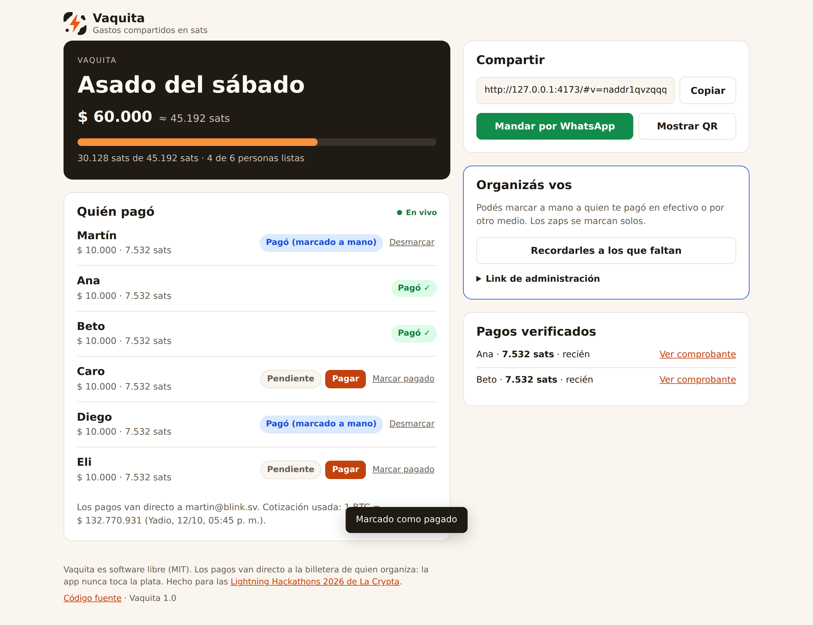
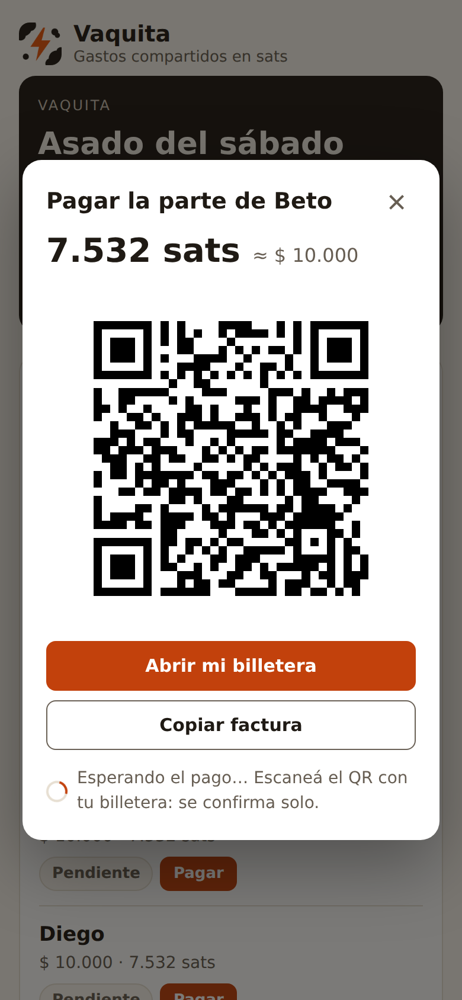
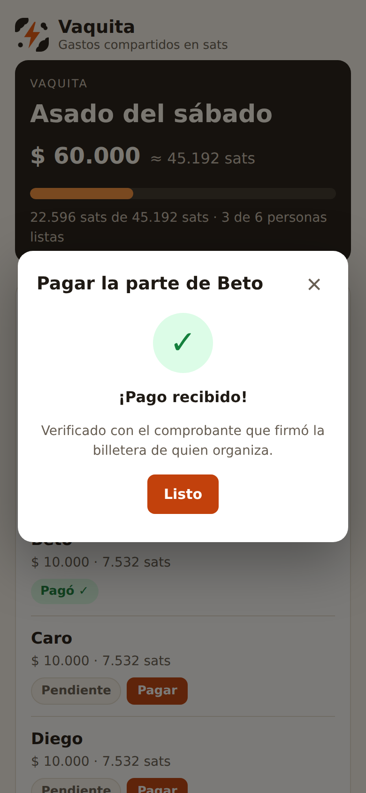
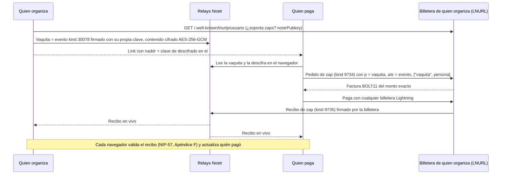

# Vaquita ⚡ — gastos compartidos en sats

**Dividí un gasto entre amigos, compartí un link y cada uno paga su parte con Lightning. Cada pago se verifica solo con zaps de Nostr: nadie tiene que mandar capturas.**

🌐 **App:** https://peshino2012.github.io/vaquita-sats/
🏆 Proyecto para [Lightning Hackathons 2026 #8 — INTEGRATION](https://github.com/lacrypta/hackathons-2026) de La Crypta.

| Quien organiza (escritorio) | Quien paga (celular) | Pago verificado |
|---|---|---|
|  |  |  |

## El problema

En Argentina "hacer la vaquita" es parte de cualquier asado, cumpleaños o viaje. Siempre pasa lo mismo: alguien pone la plata, después persigue a los demás por WhatsApp y tiene que confiar en capturas de transferencias. Con Lightning, el pago es instantáneo y barato. Lo que faltaba era una forma simple de que **todos vean quién pagó, con pruebas, sin una cuenta ni un intermediario que guarde la plata**.

## Cómo se usa

1. **Creás la vaquita:** para qué es, cuánto salió (en pesos o en sats), quiénes ponen y tu Lightning Address. La app toma la cotización del bitcoin y calcula la parte de cada uno.
2. **Compartís el link** por WhatsApp o con un QR.
3. **Cada uno toca "Pagar"** en su nombre, escanea el QR con cualquier billetera Lightning (o usa WebLN) y listo.
4. **Todos ven el progreso en vivo.** Cada pago aparece verificado con su comprobante. Quien organiza puede marcar a mano a quien pagó en efectivo y mandar un recordatorio a los que faltan.

No hace falta cuenta, ni instalar nada, ni conocer Nostr. Funciona como app instalable (PWA).

### Probalo en 2 minutos

1. Abrí la app y creá una vaquita de prueba: total `100` **sats**, dos nombres y tu Lightning Address. Sirven Blink, Wallet of Satoshi, Coinos, Primal, Strike o npub.cash.
2. Abrí el link en otro dispositivo o en una ventana privada y tocá **Pagar** en el segundo nombre.
3. Pagá los 50 sats desde **otra** billetera. En segundos la fila pasa a "Pagó ✓" en las dos pantallas, y en "Pagos verificados" aparece el comprobante, que podés abrir en njump.

## Cómo funciona



- **La vaquita es un evento Nostr direccionable** (`kind 30078`, NIP-78) firmado con una clave nueva que se genera para esa vaquita. Así cada vaquita tiene su propia identidad y los recibos se filtran por `#p`.
- **Cada aporte es un zap** (NIP-57) dirigido a esa clave. El pedido de zap lleva la etiqueta `["vaquita", "p3"]`, que dice a quién corresponde el pago. Viaja dentro del recibo firmado por la billetera.
- **La verificación no depende de confiar en nadie que participe.** Un recibo solo cuenta si cumple todo esto:
  - lo firmó el servidor LNURL de quien organiza (su `nostrPubkey`);
  - el pedido embebido tiene firma válida y apunta a esta vaquita;
  - el monto de la factura coincide con el pedido.

  Un recibo trucho se ignora; hay un test E2E de esto.
- **Las ediciones** (marcar pagos en efectivo) son nuevas versiones del mismo evento direccionable, firmadas con la clave de la vaquita, y le llegan en vivo a todos.

### Qué integra

| Pieza | Estándar | Para qué |
|---|---|---|
| Pagos Lightning | LUD-06 / LUD-16 (Lightning Address), BOLT11, WebLN | Facturas del monto exacto a la billetera de quien organiza |
| Zaps | NIP-57 | Comprobante público y verificable de cada pago |
| Identidad Nostr | NIP-01, claves por vaquita | Firmar la vaquita y sus ediciones sin cuentas |
| Datos de la app | NIP-78 (`kind 30078`), NIP-31 (`alt`) | La vaquita vive en los relays, no en un servidor propio |
| Links | NIP-19 (`naddr`, `nevent`) | Link para compartir y link al comprobante en njump |
| Comercio | Cotización BTC/ARS (Yadio, con CriptoYa y CoinGecko de respaldo) | Cargar el gasto en pesos y cobrar en sats |
| Privacidad | AES-256-GCM (WebCrypto) | Los relays no ven nombres, montos en pesos ni el título |
| App | PWA, service worker, CSP estricta | Instalable, abre sin conexión, sin scripts de terceros |

## Seguridad y privacidad

- **La app nunca toca la plata.** Los pagos van directo de billetera a billetera. Solo se usa la Lightning Address pública: no hay claves de billetera, NWC ni tokens en el frontend.
- **Contenido cifrado de punta a punta.** El título, los nombres y los montos se cifran con AES-256-GCM. La clave viaja en el fragmento del link (`#k=…`), que el navegador nunca manda a ningún servidor. Los relays solo guardan texto cifrado; hay un test E2E que lo comprueba.
- **Qué es público:** los recibos de zap (montos en sats, la clave pública de la vaquita y a qué fila corresponde cada pago). No incluyen nombres.
- **Clave de administración:** queda en el dispositivo de quien organiza. Para usarla en otro dispositivo hay un "link de administración" con un aviso explícito. Cuando se abre ese link, el secreto se quita de la barra de direcciones.
- **Sin dependencias en tiempo de ejecución desde CDNs.** `nostr-tools` y el generador de QR están empaquetados en `vendor/`, y CI verifica que el bundle corresponda a las versiones declaradas.
- **CSP estricta:** sin scripts inline ni de terceros. Todo el contenido de usuario se inserta con `textContent`, nunca con `innerHTML`.

## Probado con billeteras y relays reales

El workflow [`billeteras-reales`](.github/workflows/billeteras-reales.yml) corre todas las semanas contra servicios reales, con el mismo código que usa la app. Pide una factura con un pedido de zap de Vaquita (sin pagarla), publica una vaquita cifrada y la vuelve a leer. Último resultado en [`probe/zaps-reales.json`](probe/zaps-reales.json):

| Billetera | Zaps (NIP-57) | Acepta el pedido de zap de Vaquita |
|---|---|---|
| Blink | ✅ | ✅ (además soporta LUD-21) |
| Wallet of Satoshi | ✅ | ✅ |
| Coinos | ✅ | ✅ |
| Primal | ✅ | ✅ |
| Strike | ✅ | ✅ (mínimo 100 sats) |
| npub.cash | ✅ | ✅ |

| Relay | Publica y devuelve la vaquita |
|---|---|
| relay.lacrypta.ar | ✅ |
| relay.damus.io | ✅ |
| nos.lol | ✅ |
| relay.primal.net | ✅ |

## Desarrollo

```bash
npm install
npm start            # http://127.0.0.1:4173 (con `node e2e/servidor.mjs --relay`, también un relay local)
npm test             # 23 tests unitarios: montos, cifrado, LNURL, cotización, validación de recibos
npm run test:e2e     # 5 tests de punta a punta en Chromium con relay local y billetera simulada
npm run vendor       # regenera vendor/ desde node_modules
```

No hay paso de build: la app son módulos ES servidos tal cual, así que el mismo código corre en GitHub Pages, en los tests y en el navegador.

| Archivo | Qué hace |
|---|---|
| `logic.js` | Lógica pura: reparto sin perder centavos, pesos ↔ sats, estado de pagos, links |
| `cripto.js` | Cifrado AES-256-GCM con WebCrypto |
| `lightning.js` | Lightning Address, pedido de zap, factura y validación de recibos (NIP-57 Apéndice F) |
| `nostr.js` | Publicar y escuchar la vaquita y los recibos en los relays |
| `precio.js` | Cotización BTC/ARS con tres fuentes |
| `app.js` | Interfaz |
| `e2e/` | Tests de Playwright, relay Nostr local y generador de capturas |
| `test/` | Tests unitarios y billetera LNURL simulada que firma recibos como una real |
| `probe/` | Pruebas contra billeteras y relays reales |

## Limitaciones conocidas

- Quien organiza necesita una billetera que emita zaps (NIP-57). Si no la tiene, la app se lo avisa al crear la vaquita y le sugiere opciones.
- La parte de cada uno en sats se fija con la cotización del momento de crear la vaquita.
- Cualquiera que tenga el link ve los nombres y puede pagar la parte de cualquiera. Es a propósito, porque así se usa entre amigos.
- Si todos los relays configurados borraran el evento, la vaquita no se podría abrir. Por eso se publica en cuatro relays.

## Licencia

MIT. Hecho en Argentina 🇦🇷 con ⚡.
